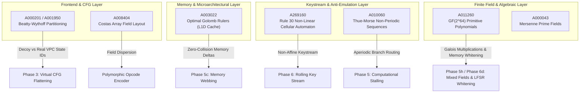

# OEIS Mathematical Sequences in ASGARD-5877

This document catalogs the integer sequences from the **On-Line Encyclopedia of Integer Sequences (OEIS)** utilized in the algebraic, cryptographic, and devirtualization-resistant transformations of the ASGARD-5877 virtual machine protector.

---

## 1. Overview & Threat Model Alignment

Automated deobfuscation tools (angr, Triton, D810, IDA Hex-Rays) rely heavily on algebraic simplifiers, SAT/SMT bit-vector solvers (Z3, CVC5), and statistical correlation analyzers. These tools excel at breaking:
* Standard Linear Congruential Generators (LCG) and affine permutations.
* Periodic loop structures with predictable induction variables.
* Memory access patterns with recurring relative address deltas.
* Fixed instruction field layouts susceptible to n-gram frequency analysis.

By integrating combinatorial and non-linear sequences cataloged in OEIS, ASGARD-5877 injects mathematically proven properties that:
1. **Force SAT Clause Explosion**: Non-linear bitwise cellular automata destroy affine bit-slice relations.
2. **Prevent Cache-Timing Attacks**: Difference-free sets ensure zero address delta collisions across memory accesses.
3. **Eliminate Graph Hubs & Periodic Loops**: Non-periodic words (such as Thue-Morse) prevent loop summarization and taint unification.
4. **Partition State Spaces Branchlessly**: Beatty sequences enable disjoint state and block allocation without lookup tables.

---

## 2. Engineering Policy & Offline Determinism

* **Offline Invariant**: The ASGARD compiler and VM packaging pipeline (`main.exe protect-...`) **MUST NEVER** perform dynamic network calls to `oeis.org` during protected binary compilation. Builds must remain 100% air-gapped, reproducible, and deterministic.
* **Constant Registry Rule**: Any scalar constant, mask, polynomial coefficient, or table derived from OEIS must be registered in `lib/constants/magic_numbers.ml` with its canonical sequence ID (e.g., `OEIS A003022`) and mathematical provenance (per `AGENTS.md` Rule 3).
* **Formal Verification**: Any algebraic identity or invariant constructed using OEIS sequences must be verified in Z3 SMT `QF_BV` in `test/test_stack_vm.ml`.

---

## 3. Catalog of OEIS Sequences in the Architecture

---

### 3.1 Beatty & Wythoff Sequences: Disjoint State Partitioning
* **OEIS Identifiers**:
  * [A000201](https://oeis.org/A000201): Lower Wythoff sequence: $a_n = \lfloor n \phi \rfloor$, where $\phi = \frac{1+\sqrt{5}}{2} \approx 1.6180339887...$
  * [A001950](https://oeis.org/A001950): Upper Wythoff sequence: $b_n = \lfloor n \phi^2 \rfloor = a_n + n$.
* **Mathematical Theory (Rayleigh-Beatty Theorem)**:
  Let $r, s > 1$ be irrational numbers such that $\frac{1}{r} + \frac{1}{s} = 1$. The Beatty sequences $S_r = \{\lfloor n r \rfloor\}_{n=1}^{\infty}$ and $S_s = \{\lfloor n s \rfloor\}_{n=1}^{\infty}$ partition the positive integers $\mathbb{N}^+$:
  $$S_r \cap S_s = \emptyset, \quad S_r \cup S_s = \mathbb{N}^+$$
  Since $\frac{1}{\phi} + \frac{1}{\phi^2} = \frac{\phi - 1 + 1}{\phi^2} = 1$, $a_n$ and $b_n$ form an exact, non-overlapping partition of all integers:
  $$\{a_n\} = \{1, 3, 4, 6, 8, 9, 11, 12, 14, 16, 17, 19, 21, \dots\}$$
  $$\{b_n\} = \{2, 5, 7, 10, 13, 15, 18, 20, 23, 26, 28, 31, 34, \dots\}$$
* **Application in ASGARD-5877**:
  * **Decoy vs. Real VPC Block ID Allocation (Phase 3 CFF & Phase 4b Braided CFG)**: Real execution blocks draw their virtual state identifiers from $a_n \in A000201$, while decoy trap blocks draw identifiers from $b_n \in A001950$.
  * **Branchless Legitimacy Validation**: Legitimacy of a block token $x$ is verifiable branchlessly without maintaining dispatch lookup tables in memory, defeating automated state-space enumeration.

---

### 3.2 Optimal Golomb Rulers: D-Cache Collision-Free Memory Webbing
* **OEIS Identifier**: [A003022](https://oeis.org/A003022) — Length of shortest (optimal) Golomb ruler with $n$ marks.
* **Mathematical Theory**:
  A Golomb ruler is a set of distinct non-negative integers $A = \{a_1, a_2, \dots, a_n\}$ such that all pairwise differences are distinct:
  $$\forall i \ne j, l \ne k: \quad a_j - a_i = a_l - a_k \implies (i = l \land j = k)$$
* **Optimal Mark Sets**:
  * 4 marks (length 6): $\{0, 1, 4, 6\}$ (6 unique differences: $1, 2, 3, 4, 5, 6$)
  * 5 marks (length 11): $\{0, 1, 4, 9, 11\}$ (10 unique differences: $1, 2, 3, 4, 5, 7, 8, 9, 10, 11$)
  * 6 marks (length 17): $\{0, 1, 4, 10, 12, 17\}$ (15 unique differences)
  * 8 marks (length 34): $\{0, 1, 4, 9, 15, 22, 32, 34\}$ (28 unique differences)
* **Application in ASGARD-5877**:
  * **Coupled Secret Sharing in Memory Webbing (Phase 5c)**: Memory offsets allocated in the thread-local `host_stack` are constructed as scaled multiples of Golomb marks:
    $$\mathrm{addr}_i = \mathrm{Base} + 8 \cdot a_i$$
  * **DRCC Top-Of-Stack Register Window & Golomb-4 Invariants (Phase 6c / Pass 22)**: The 4-mark ruler $G_4 = \{0, 1, 4, 6\}$ provides the pairwise difference set $\Delta \in \{1, 2, 3, 4, 5, 6\}$. Register-cached ALU operations apply asymmetric Golomb zero-knots $\big((s + \Delta) - (s \land \Delta)\big) - (s \lor \Delta) \equiv 0 \pmod{2^{64}}$, ensuring that each register window spill and fill transition exhibits an unrepeatable algebraic difference profile.
  * **Microarchitectural & SMT Defense**: Because no two pairs $(a_j, a_i)$ share the same distance:
    1. **Zero D-Cache Line Collisions**: Memory access streams cannot produce identical cache set conflict patterns, neutralizing *Flush+Reload* and *Prime+Probe* side-channel analysis.
    2. **SMT Memory Disambiguation Breakdown**: In SMT solvers with array theory (QF_ABV), expressions of the form $\operatorname{select}(\operatorname{store}(M, a_i, v), a_j)$ can never reduce via equality conditions ($a_i = a_j \iff i = j$), preventing symbolic simplification of memory roundtrips.

---

### 3.3 Wolfram's Rule 30: Non-Linear State-Feedback Rolling Key
* **OEIS Identifiers**:
  * [A269160](https://oeis.org/A269160): Wolfram's Rule 30 formula: $a(n) = n \oplus (2n \lor 4n)$.
  * [A030101](https://oeis.org/A030101): Base sequence of cellular automaton Rule 30.
* **Mathematical Theory**:
  Rule 30 is an elementary 1D cellular automaton defined by the local update rule:
  $$s_i^{(t+1)} = s_{i-1}^{(t)} \oplus \big(s_i^{(t)} \lor s_{i+1}^{(t)}\big)$$
  On 64-bit integer registers with circular boundary conditions, this is computed bit-parallel in three instructions:
  $$\operatorname{step}(x) = \operatorname{rotl}_{64}(x, 1) \oplus \big(x \lor \operatorname{rotr}_{64}(x, 1)\big)$$
* **Application in ASGARD-5877**:
  * **Pass 24 (Phase 6e): Wolfram Rule 30 Non-Linear Keystream & Cellular Automaton Diffusion (`stack_rule30_pass.ml`)**:
    Evolves a dedicated keystream state slot $K_t$ via bit-parallel Rule 30 updates ($K_{t+1} = R_{30}(K_t) \oplus \operatorname{Salt}_{\text{rule30}}$) and injects invariant zero-knots $(R_{30}(v) \oplus \operatorname{rotl}(v, 1)) \oplus (v \lor \operatorname{rotr}(v, 1)) \equiv 0 \pmod{2^{64}}$ across guest register reads.
  * **SMT Bit-Vector Inversion Resistance**: In SAT-based bit-vector reasoning, the non-linear coupling of $\operatorname{OR}$ and $\operatorname{XOR}$ prevents linear Gaussian reduction across key steps, causing exponential clause count explosion during bounded model checking.
---

### 3.4 Thue-Morse Sequence: Infinite Aperiodic Computational Stalling
* **OEIS Identifier**: [A010060](https://oeis.org/A010060) — Thue-Morse sequence.
* **Mathematical Theory**:
  The sequence is defined recursively by $A_0 = 0$, $A_{k+1} = A_k \overline{A_k}$, or explicitly by the parity of the binary representation of $n$:
  $$t_n = \operatorname{popcount}(n) \pmod 2$$
  *Properties*:
  1. **Overlap-Free**: Contains no subword of the form $c w c w c$ where $c \in \{0, 1\}$.
  2. **Cube-Free**: Contains no subword of the form $w w w$.
  3. **Aperiodic**: Contains no periodic tail or recurring cycle.
* **Application in ASGARD-5877**:
  * **Computational Stalling (Anti-Emulation Pass)**: Emulation detection loops evaluate mathematical sequences to accentuate CPU vs. emulator performance gaps. Loops unrolled with branches steered by $t_n$ exhibit zero repeating branch prediction patterns.
  * **Defeating Loop Induction Analysis**: Symbolic deobfuscators attempting to summarize loops into closed-form algebraic expressions fail because the state transition sequence lacks a repeating period, while the VM evaluates $t_n$ branchlessly in a single instruction (`popcnt` / `__builtin_parity`).

---

### 3.5 Costas Arrays: 2D Instruction Field Layout Randomization
* **OEIS Identifier**: [A008404](https://oeis.org/A008404) — Costas arrays and Costas permutations.
* **Mathematical Theory**:
  A Costas array of order $n$ is an $n \times n$ permutation matrix in which all $\binom{n}{2}$ displacement vectors between pairs of 1s are distinct:
  $$\forall i \ne j: \quad (j - i, \pi(j) - \pi(i)) \text{ is unique}$$
* **Application in ASGARD-5877**:
  * **Pass 26 (Phase 8b): Order-6 Costas Bytecode Field Permutation (`stack_encoder.ml`)**:
    Bytecode instructions with multi-field operands (`JccRel`, `Cmov`, `SetRegImm`, `AddRegImm`, `AddImmImm`, `SubImmImm`) have their operand field order governed by a 6-tuple of boolean flags derived from verified order-6 Costas arrays.
  * Because the 40 order-6 Costas arrays guarantee that all $\binom{6}{2} = 15$ displacement vectors $(\Delta x, \Delta y)$ are pairwise distinct, the 2D cross-correlation between operand byte offsets across the instruction stream drops to the theoretical minimum. Deep learning disassemblers and n-gram statistical classifiers cannot detect instruction boundaries or field alignments.
  * **SubImmImm Invariant Preservation**: Swapped operand order in `SubImmImm` is compensated in the C++ runtime handler `h_sub_ii` by evaluating $\text{second} - \text{first} \equiv a - b$, guaranteeing semantic equivalence.
---

### 3.6 Primitive Polynomials over GF(2): Maximum-Period Galois Automorphisms
* **OEIS Identifiers**:
  * [A011260](https://oeis.org/A011260): Number of primitive polynomials of degree $n$ over $\mathrm{GF}(2)$.
  * [A002475](https://oeis.org/A002475): Coefficients of primitive polynomials over $\mathrm{GF}(2)$.
* **Mathematical Theory**:
  A primitive polynomial $P(x)$ of degree $n$ over $\mathrm{GF}(2)$ generates the Galois field $\mathrm{GF}(2^n)$ and defines a maximum-length linear sequence with period $2^n - 1$.
  For $n = 64$:
  $$P_{64}(x) = x^{64} + x^4 + x^3 + x + 1$$
* **Application in ASGARD-5877**:
  * **Mixed-Characteristic Finite Field Arithmetic (Phase 5h)**: Injects Galois field distributivity knots:
    $$\operatorname{xtime}(s \oplus C) \oplus \operatorname{xtime}(s) \oplus \operatorname{xtime}(C) \equiv 0 \pmod{P_{64}(x)}$$
  * Because $\mathrm{GF}(2^{64})$ addition is purely $\operatorname{XOR}$ while polynomial multiplication incorporates degree-64 modular reduction, SMT bit-vector solvers cannot simplify expressions intertwining $\mathbb{Z}_{2^{64}}$ integer addition and $\mathrm{GF}(2^{64})$ multiplication.

---

### 3.7 Mersenne Prime Exponents: Branchless Modular Folding
* **OEIS Identifier**: [A000043](https://oeis.org/A000043) — Mersenne prime exponents $p$ such that $M_p = 2^p - 1$ is prime.
  $$p \in \{2, 3, 5, 7, 13, 17, 19, 31, 61, 89, 107, 127, \dots\}$$
* **Mathematical Theory**:
  For any integer $x$ in a 64-bit word and prime $M_{31} = 2^{31} - 1$, modular reduction is computed branchlessly without integer division:
  $$x \equiv (x \land M_{31}) + (x \gg 31) \pmod{M_{31}}$$
  Repeating the fold at most twice guarantees reduction into $[0, M_{31}]$.
* **Application in ASGARD-5877**:
  * **Mersenne-31 Invertibility Knots (Phase 5h & Phase 5i)**: Emits zero knots of the form:
    $$s_0 - \operatorname{fold}_{31}\Big(\operatorname{fold}_{31}(s_0 \cdot a) \cdot a^{-1}\Big) \equiv 0 \pmod{M_{31}}$$
  * Because $M_{31}$ is not a power of two, bit-vector solvers (QF_BV) cannot use standard word truncation; they must introduce non-linear integer division constraints, leading to solver timeouts.

---

### 3.8 Fractal Tiered Invalidation: Ruler Function (RD-JIT)
* **OEIS Identifier**: [A001511](https://oeis.org/A001511) — the 2-adic valuation $v_2(2n)$: $1, 2, 1, 3, 1, 2, 1, 4, \dots$
* **Application**: After execution step $t$, the sealed nano-arena always wipes the active slot and re-wipes every slot of fractal level $\le \mathrm{A001511}(t) = 1 + \mathrm{ctz}(t)$ with a fresh Rule 30 gamma (`lib/rd_jit_vm/nano_jit_slot.ml`, `arena_after_chunk`).
* **Defense**: Level-1 slots are wiped every step, level-2 every 2nd, level-3 every 4th: a process snapshot at any $t$ retains only a fractal fragment of the executed code, and hot loops never accumulate whole in memory.

---

### 3.9 Kolakoski Self-Describing Fission (RD-JIT)
* **OEIS Identifier**: [A000002](https://oeis.org/A000002) — the Kolakoski word $1, 2, 2, 1, 1, 2, 1, 2, 2, 1, \dots$ whose run lengths equal the word itself.
* **Application**: The RD-JIT emitter splits the virtual-opcode stream into native chunks whose target sizes are Kolakoski run lengths scaled by 2 (2 or 4 instructions per chunk, `lib/rd_jit_vm/rd_jit_emitter.ml`).
* **Defense**: Chunk boundaries are self-descriptive but aperiodic: disassemblers and diff tools find no fixed micro-handler size to align on.

---

### 3.10 Moser-de Bruijn Carry-Free Operand Blinding (RD-JIT)
* **OEIS Identifier**: [A000695](https://oeis.org/A000695) — sums of distinct powers of 4 (bits on even positions only).
* **Mathematical Theory**: Every $N \in \mathbb{N}$ decomposes uniquely as $N = X + 2Y$ with $X, Y \in \mathrm{A000695}$; the bit planes of $X$ and $2Y$ are disjoint, so $X + 2Y = X \oplus 2Y$ — no carries ever cross the planes.
* **Application**: Every immediate operand crosses the chunk seal packed as the pair of compacted planes (`moser_pack`/`moser_unblind`), and the runtime recombines them by bit spreading; ADD and XOR recombination are interchangeable.
* **Defense**: Differential analysis of operand fields cannot distinguish carry-propagating from carry-free encodings.

---

### 3.11 Derangement Register Shuffle (RD-JIT)
* **OEIS Identifier**: [A000166](https://oeis.org/A000166) — subfactorials (count of fix-free permutations).
* **Application**: Chunk $k$ permutes its virtual-register operands with a nibble-packed fix-free permutation $\pi_k$ of the 16-entry gprs file (four registered derangements, identity at external-call ABI boundaries); between chunks the runtime re-permutes the register file (`remap_gprs`), so $\pi_k(i) \ne i$ for every slot in every adjacent pair of chunks.
* **Defense**: No physical register slot keeps its virtual meaning in two adjacent JIT chunks, breaking type/constant propagation in decompilers.

---

### 3.12 Stern Diatomic Affine Transfer (RD-JIT)
* **OEIS Identifier**: [A002487](https://oeis.org/A002487) — Stern's diatomic series with $\gcd(a(n), a(n{+}1)) = 1$.
* **Application**: Inter-chunk transfers cross the shuffle window affine-encrypted with $\alpha_n = 2a(n)+1$ (odd, hence a unit of $\mathbb{Z}_{2^{64}}$); $\alpha_n^{-1}$ is computed in the runtime by five Newton-Raphson iterations, without division tables.
* **Defense**: Each chunk boundary runs in its own numeric ring; the masked transfer window carries no linear relation to the live register values.

---

### 3.13 Padovan Buffer Dispersion (RD-JIT)
* **OEIS Identifier**: [A000931](https://oeis.org/A000931) — Padovan sequence, plastic constant $\psi \approx 1.3247$ ($\psi^3 = \psi + 1$).
* **Application**: The dual-mapped JIT buffer is partitioned as code : metadata : spill $= \psi^{-5} : \psi^{-4} : \psi^{-3}$ of capacity (fixed-point multiplies by the registered fractions); the W^X synthesis lifecycle is scoped to the code region, the derangement/Stern tables live in the metadata region, and the sealed nano-arena is backed by the spill region.
* **Defense**: No region boundary lands on a power-of-two or harmonic offset, eliminating pseudo-periodic TLB/L2/L3 aliasing between code, metadata, and arena traffic.

---

## 4. Summary Table of Integrated Sequences

| **OEIS ID** | Name / Description | Algebraic Structure | ASGARD-5877 Phase / Subsystem | Defense Mechanism |
|---|---|---|---|---|
| **A000201** / **A001950** | Lower / Upper Wythoff Beatty Sequences | $\lfloor n\phi \rfloor$, $\lfloor n\phi^2 \rfloor$ | Phase 3 (CFF), Phase 4b (Braid), RD-JIT nano-arena | Disjoint real vs. decoy VPC state allocation; branchless slot legitimacy |
| **A003022** | Optimal Golomb Rulers | Distinct pairwise differences | Phase 5c (Memory Webbing), RD-JIT nano-arena slots | Zero-collision L1D cache addresses & SMT array disambiguation |
| **A269160** | Wolfram's Rule 30 Cellular Automaton | $n \oplus (2n \lor 4n)$ | Phase 6 (State-Feedback Rolling Key), RD-JIT slot wipe | SAT clause explosion in backward symbolic execution |
| **A010060** | Thue-Morse Sequence | $\operatorname{popcount}(n) \bmod 2$ | Phase 5 (Computational Stalling), RD-JIT dummy opcodes | Aperiodic loop control defeating loop summarization |
| **A008404** | Costas Arrays | 2D distinct distance vectors | Bytecode Polymorphic Encoder | Elimination of 2D byte n-gram correlations |
| **A011260** | Primitive Polynomials over $\mathrm{GF}(2)$ | $x^{64} + x^4 + x^3 + x + 1$ | Phase 5h & 6d (Memory Whitening) | Characteristic-2 Galois ring operations & LFSR snapshot diff resistance |
| **A000043** | Mersenne Prime Exponents | $M_p = 2^p - 1$ | Phase 5h & 5i (I/O Sink Barrier) | Non-power-of-two modular folding forcing integer SMT timeouts |
| **A001511** | Ruler Function $v_2(2n)$ | $1 + \mathrm{ctz}(t)$ | RD-JIT fractal invalidation | Fractal memory residue: hot loops never accumulate whole |
| **A000002** | Kolakoski Word | Self-describing run lengths | RD-JIT chunk fission | Aperiodic, self-descriptive chunk boundaries |
| **A000695** | Moser-de Bruijn Sequence | $N = X + 2Y$, $X + 2Y = X \oplus 2Y$ | RD-JIT operand blinding | Carry-free planes; ADD/XOR interchangeable |
| **A000166** | Derangements $!n$ | Fix-free permutations | RD-JIT register shuffle | No slot keeps its meaning across adjacent chunks |
| **A002487** | Stern's Diatomic Series | $\gcd(a(n), a(n{+}1)) = 1$ | RD-JIT affine transfer | Per-boundary ring; NR-inverse without division tables |
| **A000931** | Padovan / Plastic Constant | $\psi^3 = \psi + 1$ | RD-JIT buffer dispersion | Non-harmonic code/metadata/spill region offsets |
