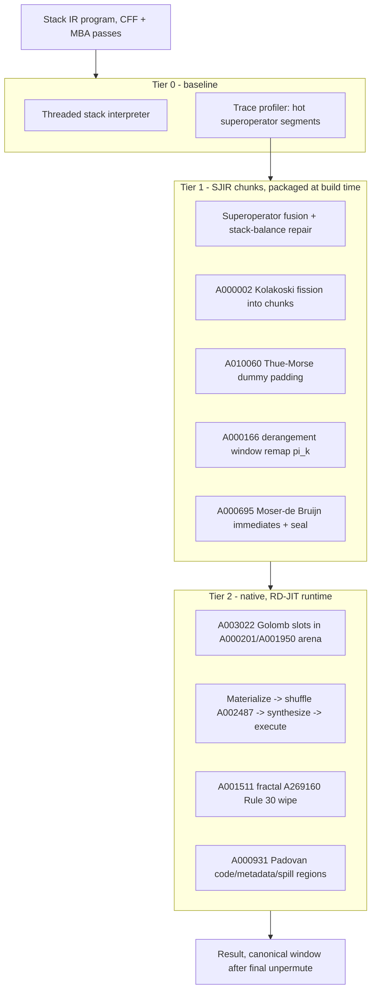

# Stack JIT VM Prototype (SJIT)

Prototype design for a tiered stack-JIT execution engine: the Stack-VM
front end records hot traces and lowers them into sealed native chunks of
the RD-JIT nano-arena.  The document separates, explicitly, what is
*mathematically anchored* (semantic preservation, in the Isabelle/HOL
Archive of Formal Proofs pattern), what is *machine-checked* (decidable
finite facts), and what is *heuristic* (anti-analysis claims that no
current formalization touches).  This is a design specification, not an
implementation; module references point at the existing components it
reuses.

## 1. Scope and reuse

| Component | Status | Role in SJIT |
|---|---|---|
| Stack IR + 25 protection passes (`lib/stack_vm/`) | exists | front end, trace source |
| Superoperator fusion pass | exists | trace candidates |
| RD-JIT sealed chunk runtime (`lib/rd_jit_vm/`) | exists | native tier: arena, sealing, wipe, transfers |
| Stack chunker (fission, balancing, dummies) | prototype | tier-1 lowering, this document |
| Isabelle verification entry | plan | section 7 |

The engine follows the three-tier shape of the AFP entry
`Interpreter_Optimizations` (Std -> Inca -> Ubx): a baseline interpreter,
an inline-optimized tier, and an optimized native tier.  The *goal* for
each tier pair is a lockstep bisimulation; section 6 states exactly what
such a bisimulation proves and what it does not.

## 2. Formal anchors, sorted by what they actually prove

### 2.1 Anchors that carry the logical weight

| Anchor | What is proven there | What that proves for SJIT |
|---|---|---|
| [Interpreter_Optimizations](https://isa-afp.org/entries/Interpreter_Optimizations.html) (2020), `Std_to_Inca_simulation.thy` | `norm_instr` erasure, `rel_fundefs`, `match`, `backward_lockstep_simulation`, `forward_lockstep_simulation`, `match_final_forward/backward` between a baseline stack VM and an optimized tier | The template for tier-0/tier-2 *semantic agreement*; nothing about obfuscation strength |
| [VeriComp](https://isa-afp.org/entries/VeriComp.html) (2020) | Generic `Simulation` locale for verified compiler transformations | Locale structure of the simulation proofs |
| [Jinja](https://isa-afp.org/entries/Jinja.html) (2005), [JinjaThreads](https://isa-afp.org/entries/JinjaThreads.html) (2007) | Unified source/VM/compiler model; compiler preserves semantics and well-typedness; weak bisimilarity | Shape of the end-to-end agreement theorem |
| [Derangements](https://isa-afp.org/entries/Derangements.html) (2015) | `derangements S = {p. p permutes S & !x in S. p x ~= x}`; `p permutes S` makes `p` a bijection; `derangements_inv: d : derangements S ==> inv d : derangements S` | The *bijection* half is what makes the window shuffle a lossless storage move (semantic).  Fixpoint-freeness is the hardening goal, not a correctness requirement; `derangements_inv` supports inverse-table reasoning if needed |
| [Continued_Fractions](https://isa-afp.org/entries/Continued_Fractions.html) (2024), [Linear_Recurrences](https://isa-afp.org/entries/Linear_Recurrences.html) (2017) | Periodic continued fractions are precisely the quadratic irrationals; golden-ratio closed form | Irrationality of phi - the hypothesis Beatty's partition disjointness needs.  Bridging to the implementation's fixed-point check is an explicit obligation (section 7), not done by the entry |

### 2.2 Thematic anchors (adjacent mathematics, not proving the SJIT property)

| Anchor | What is proven there | Why it is adjacent only |
|---|---|---|
| [Stern_Brocot](https://isa-afp.org/entries/Stern_Brocot.html) (2015) | `fusc`/`fusc'` corecursive streams; `stern_brocot_coprime` (tree entries coprime); `step (n,d) = (d, n+d-2*(n mod d))` | Gives a verified *generator* for the alpha sequence.  The invertibility of `alpha_k = 2*fusc(k)+1` mod `2^64` follows from oddness alone - true for any integer argument, coprime or not - so the coprimality theorem does no logical work there.  If a stronger claim (decorrelation of successive factors) were needed, coprimality would not establish it either; SJIT claims only: deterministic, non-repeating odd units |
| [Combinatorics_Words](https://isa-afp.org/entries/Combinatorics_Words.html) (2021) | `Periodicity_Lemma` (Fine-Wilf), `Lyndon_Schutzenberger`, morphisms | The right toolkit for future aperiodicity proofs; cube-freeness of the Kolakoski word itself is literature (Carpi 1994, via [OEIS A000002](https://oeis.org/A000002)), not formalized |

## 3. OEIS foundation, with evidence classes

| OEIS | Property | SJIT role | Evidence class |
|---|---|---|---|
| [A000002](https://oeis.org/A000002) Kolakoski | Self-describing run lengths; cubefree (squares only of length 2, 4, 6, 18, 54) | Chunk fission sizes | Combinatorial fact: literature (Carpi 1994), unformalized.  The *engineering* claim (harder loop summarization) is heuristic - see section 6.2 |
| [A010060](https://oeis.org/A010060) Thue-Morse | Overlap-free, cube-free | Dummy opcode positions | Proven combinatorics (textbook); anti-analysis effect heuristic |
| [A001511](https://oeis.org/A001511) Ruler | `v2(2t) = 1 + ctz(t)` | Fractal wipe schedule | Elementary arithmetic (trivially dischargeable in Isabelle) |
| [A269160](https://oeis.org/A269160) Rule 30 | `step(x) = rotl(x,1) ^ (x | rotr(x,1))` | Wipe gamma | Heuristic/empirical.  Non-linearity over GF(2) is a speed bump, not a proof; Rule-30 constructions have a record of falling to algebraic and SAT attacks - no security claim is made beyond "non-invertible by Gaussian elimination" |
| [A003022](https://oeis.org/A003022) Golomb rulers | Pairwise distinct differences | Active slot placement; frame-slot spacing | Machine-checked for the ruler actually used (decidable finite fact; `RD JIT Nano-OEIS Invariants` test) |
| [A000201](https://oeis.org/A000201) / [A001950](https://oeis.org/A001950) Beatty-Wythoff | Disjoint partition of N+ (given irrational phi) | Real-vs-honeypot arena units | Theorem (Rayleigh); the *implementation's* fixed-point `floor(n*phi)` check needs a rounding argument over the arena range - obligation in section 7 |
| [A000695](https://oeis.org/A000695) Moser-de Bruijn | Unique `N = X + 2Y`, `X + 2Y = X xor 2Y` | Immediate blinding | Elementary bit-plane disjointness; roundtrip-tested, straightforwardly provable |
| [A000166](https://oeis.org/A000166) Derangements | `!n` fix-free permutations | Window shuffle | Definition and closure in AFP (section 2.1); semantic half proven, hardening half heuristic |
| [A002487](https://oeis.org/A002487) Stern diatomic | Odd units `alpha_n = 2*fusc(n)+1` | Inter-chunk transfer factors | Generation anchored (Stern_Brocot `fusc`); invertibility by construction (oddness); no decorrelation claim |
| [A000931](https://oeis.org/A000931) Padovan | Defining identity `psi^3 = psi + 1` | Region spacing | The identity is elementary and *proves nothing about dispersion*; the non-harmonic-spacing benefit is a heuristic claim, same class as other cache/TLB arguments |

All constants are registered in `lib/constants/magic_numbers.ml` per
`AGENTS.md` Rule 3; the generators live in `lib/rd_jit_vm/nano_jit_slot.ml`
and are reused verbatim.

## 4. Architecture

State model.  The interpreter state `(F, w)` is a stack frame `F` and a
16-slot *stack cache window* `w` holding the top-of-stack suffix (the DRCC
`tos0`/`tos1` idea generalized).  Chunks read and write `w`; overflow
spills into the frame, which lives in the Padovan spill region at
Golomb-spaced slot offsets.

## 5. Compilation scheme (Stack IR -> sealed chunks)

1. **Trace selection.**  The profiler marks straight-line superoperator
   traces with hotness above threshold; the stack-balance repair pass
   (`stack_balance_pass.ml`) restores net stack delta 0 per trace so every
   chunk boundary observes a balanced frame.
2. **Fission (A000002).**  The trace splits into chunks of
   `K(n) * 2` fused stack ops (sizes 2 or 4).  Combinatorially, the word
   is cubefree, so the size sequence lacks short cubic repetitions; any
   claim beyond that (effect on specific decompilers) is out of scope of
   the mathematics and belongs to empirical evaluation.
3. **Padding (A010060).**  A stack-neutral flag-dead dummy pair
   (`PushImm 0; Pop`) is emitted at stream position `n` whenever
   `t_n = 1`.
4. **Window remap (A000166).**  Chunk `k` addresses window slot `i` as
   `pi_k(i)`.  Correctness rests on `pi_k` being a *permutation*
   (bijection: the storage move is lossless - AFP `derangements` locale);
   fixpoint-freeness is the hardening objective and carries no semantic
   weight.  Identity tables are used at external-call ABI boundaries.
5. **Transfer (A002487).**  The inter-chunk window crosses the shuffle
   affine-masked with `alpha_k = 2*fusc(k) + 1`.  Invertibility holds
   *because the factor is odd by construction* - coprimality of
   consecutive fusc values is not needed for it and is not claimed to
   provide any decorrelation; the role of `fusc` is a verified,
   non-repeating generator of odd units.  Inversion runs five
   Newton-Raphson iterations.
6. **Blinding and sealing (A000695, A269160).**  Immediates seal as
   carry-free `X + 2Y` plane pairs; the wipe is the Rule 30 fractal
   cascade.  Both are bit-identical to the RD-JIT controller; the wipe's
   strength is empirical (section 3).

## 6. Correctness: what is provable and what is not

### 6.1 Semantic preservation (the provable half)

Following `Std_to_Inca_simulation.thy` of `Interpreter_Optimizations`:

* **Erasure.**  `norm_chunk :: sjir_instr -> stack_op` drops dummies and
  window indirection (`pi_k` applied at seal time, invisible to
  semantics).
* **Program relation.**  `rel_chunks P cs`: the concatenation of the
  erased chunk bodies equals the fused trace of `P` after stack-balance
  repair, itself bisimilar to `P` by the existing fusion correctness.
* **State relation.**  `match s1 s2`: tier-0 state `(F, w)` and tier-2
  state agree when the window contents equal the frame suffix and the
  spill prefix is frame-equal.
* **Lockstep lemmas.**  `backward_lockstep_simulation` and
  `forward_lockstep_simulation` in the VeriComp `Simulation` locale, plus
  `match_final_forward/backward`, yield the bisimulation and the
  end-to-end agreement of the Jinja shape: tier-0 and tier-2 compute the
  same observable result.
* **Transport bijections.**  `moser_pack/moser_unpack` inverse on
  `word64`; the window shuffle is a net identity because
  `(v * alpha) * alpha^-1 = v` for odd `alpha`.  Both are exercised as
  roundtrip properties in the `RD JIT Nano-OEIS Invariants` test.

### 6.2 Anti-analysis properties (the unproven half - by design of this
document, not overlooked)

Nothing in section 6.1 or in the cited AFP entries proves that fission
impedes loop summarization, that honeypots are undetectable, that the
wipe resists SAT-based recovery, or that region spacing measurably
reduces cache/TLB leakage.  These are engineering heuristics with
combinatorial *ingredients* (cubefreeness, fixpoint-freeness,
non-linearity).  They are to be evaluated empirically - the natural
harness is the existing deobfuscation probe tiers - and any future
formalization of them would be new mathematics, not an import.

## 7. Verification plan

Isabelle entry `SJIT` (sketch), importing the anchors of section 2:

| Theory | Content | Source anchor |
|---|---|---|
| `Stack_Semantics` | stack machine small-step, frame/window state | VeriComp, Jinja |
| `SJIR` | chunk instructions, `norm_chunk`, `rel_chunks` | Interpreter_Optimizations |
| `Simulation` | `match`, lockstep backward/forward, bisimulation | VeriComp.Simulation |
| `Transport` | Moser roundtrip, odd-unit net-identity, permutation shuffle | Derangements |
| `OEIS_Generators` | `fusc` stream, Kolakoski word, Thue-Morse parity | Stern_Brocot (`fusc`) |

Open obligations:

1. Cube-freeness of the Kolakoski word (Carpi 1994) - unformalized.
2. Beatty partition disjointness *for the implementation*: the runtime
   classifies units with a fixed-point high-multiply `floor(n*phi)`;
   transferring the exact-math theorem requires a rounding-error argument
   over the arena's unit range (bounded, so decidable by finite check or
   interval arithmetic).
3. Empirical evaluation of the section 6.2 heuristics (probe harness).
4. The Rule 30 SAT-blowup remark remains an observation, not a theorem.

The OCaml property tests cover the generator-level invariants meanwhile.

## 8. Prototype milestones

1. `lib/stack_vm/stack_jit_chunker.ml`: fission + balance gating +
   Thue-Morse padding over fused traces, reusing `Nano_jit_slot.kolakoski`
   and `thue_morse`.
2. SJIR lowering to `JITInstr` streams (window ops map to the existing
   register opcodes; frame spill via `LOAD_64`/`STORE_64` on the Padovan
   spill region).
3. Packager `stack_jit` engine beside `Jit_vm_packager`, sharing the
   sealed-chunk emission.
4. E2E license example with exact-value assertions (the pattern of
   `examples/license_check_jit/`).
5. Isabelle skeleton per section 7, with the generator lemmas discharged
   first (they are within reach of the AFP imports).
