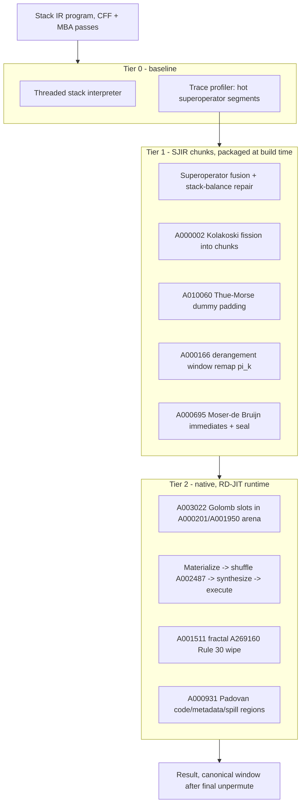

# Stack JIT VM Prototype (SJIT)

Prototype design for a tiered stack-JIT execution engine: the Stack-VM
front end records hot traces and lowers them into sealed native chunks of
the RD-JIT nano-arena.  Every mathematical mechanism is an OEIS sequence
and every correctness pattern is anchored in an Isabelle/HOL Archive of
Formal Proofs (AFP) entry.  This document is a design specification, not
an implementation; module references point at the existing components it
reuses.

## 1. Scope and reuse

| Component | Status | Role in SJIT |
|---|---|---|
| Stack IR + 25 protection passes (`lib/stack_vm/`) | exists | front end, trace source |
| Superoperator fusion pass | exists | trace candidates |
| RD-JIT sealed chunk runtime (`lib/rd_jit_vm/`) | exists | native tier: arena, sealing, wipe, transfers |
| Stack chunker (fission, balancing, dummies) | prototype | tier-1 lowering, this document |
| Isabelle verification entry | plan | section 7 |

The engine follows the three-tier shape of the AFP entry
`Interpreter_Optimizations` (Std -> Inca -> Ubx): a baseline interpreter,
an inline-optimized tier, and an optimized native tier, each pair related
by a lockstep bisimulation.

## 2. Formal anchors (Isabelle AFP)

| AFP entry | What it formalizes | Role in SJIT |
|---|---|---|
| [Jinja](https://www.isa-afp.org/entry/Jinja.html) (2005) | Unified model of source language, virtual machine and compiler; compiler correctness | Shape of the end-to-end agreement theorem (source stack program vs. native execution) |
| [JinjaThreads](https://www.isa-afp.org/entry/JinjaThreads.html) (2007) | Weak bisimilarity between source semantics and defensive VM | Bisimulation style for the tier boundary |
| [VeriComp](https://www.isa-afp.org/entry/VeriComp.html) (2020) | Generic verified-compiler framework (`Simulation` locale) | The locale structure of the simulation proofs |
| [Interpreter_Optimizations](https://www.isa-afp.org/entry/Interpreter_Optimizations.html) (2020) | Std -> Inca lockstep bisimulation (`norm_instr`, `rel_fundefs`, `match`, `backward_lockstep_simulation`, `forward_lockstep_simulation`) and Inca -> Ubx unboxing | Direct template for SJIT tiering: erasure of optimized instructions and lockstep state agreement |
| [Stern_Brocot](https://www.isa-afp.org/entry/Stern_Brocot.html) (2015) | `fusc` (Stern's diatomic sequence, OEIS A002487), `stern_brocot_coprime` (every tree entry `coprime m n`), step recurrence `(n,d) -> (d, n + d - 2*(n mod d))` | Generates the odd affine factors `alpha_n = 2*fusc(n) + 1`; coprimality grounds their invertibility mod 2^64 |
| [Derangements](https://www.isa-afp.org/entry/Derangements.html) (2015) | `derangements S = {p. p permutes S & !x in S. p x ~= x}`, `count_derangements` (OEIS A000166), `derangements_inv` | The fix-free register-window permutations and the closure of the shuffle under inverse |
| [Combinatorics_Words](https://www.isa-afp.org/entry/Combinatorics_Words.html) (2021) | Word periodicity, morphisms | Nearest anchor for the aperiodicity arguments (A010060, A000002); cube-freeness of the Kolakoski word is literature (Carpi 1994, via [OEIS A000002](https://oeis.org/A000002)), not yet AFP-formalized - listed as an obligation in section 7 |
| [Linear_Recurrences](https://www.isa-afp.org/entry/Linear_Recurrences.html) (2017), [Continued_Fractions](https://www.isa-afp.org/entry/Continued_Fractions.html) (2024) | Golden ratio as a quadratic irrational; periodic continued fractions | Irrationality of phi, the hypothesis of the Rayleigh-Beatty partition disjointness used by the arena |

## 3. OEIS foundation

| OEIS | Property used | SJIT role | Formal anchor |
|---|---|---|---|
| [A000002](https://oeis.org/A000002) Kolakoski | Self-describing run lengths; cubefree (square subword lengths only 2, 4, 6, 18, 54) | Chunk fission sizes: boundaries are aperiodic and non-cubable, loop summarizers find no fixed micro-handler size | Combinatorics_Words (partial) |
| [A010060](https://oeis.org/A010060) Thue-Morse | Overlap-free, cube-free `popcount(n) mod 2` | Dummy stack-op injection at positions `t_n = 1` | Combinatorics_Words (partial) |
| [A001511](https://oeis.org/A001511) Ruler | `v2(2t) = 1 + ctz(t)` | Fractal tiered invalidation of arena slots | none needed (elementary) |
| [A269160](https://oeis.org/A269160) Rule 30 | `step(x) = rotl(x,1) ^ (x | rotr(x,1))`, non-linear over GF(2) | Wipe gamma of executed chunks | none (SAT-blowup claim is empirical) |
| [A003022](https://oeis.org/A003022) Golomb rulers | Pairwise distinct differences | Active slot placement in the arena; stack-frame slot spacing | none (combinatorial, checked exhaustively for the used ruler) |
| [A000201](https://oeis.org/A000201) / [A001950](https://oeis.org/A001950) Beatty-Wythoff | `floor(n*phi)`, `floor(n*phi^2)` partition N+ | Real-vs-honeypot arena units; branchless slot legitimacy | Linear_Recurrences / Continued_Fractions (irrationality of phi) |
| [A000695](https://oeis.org/A000695) Moser-de Bruijn | Unique `N = X + 2Y`, `X + 2Y = X xor 2Y` | Carry-free immediate blinding across the seal | none (bit-plane disjointness, proved by roundtrip tests) |
| [A000166](https://oeis.org/A000166) Derangements | `!n` fix-free permutations | Stack-cache window shuffle between chunks | Derangements |
| [A002487](https://oeis.org/A002487) Stern diatomic | `gcd(fusc(n), fusc(n+1)) = 1` | Odd affine transfer factors `alpha_n = 2*fusc(n)+1` | Stern_Brocot (`stern_brocot_coprime`, `fusc`) |
| [A000931](https://oeis.org/A000931) Padovan | `psi^3 = psi + 1` | Code/metadata/spill region dispersion of the buffer | none (arithmetic identity) |

All constants are registered in `lib/constants/magic_numbers.ml` per
`AGENTS.md` Rule 3; the generators live in `lib/rd_jit_vm/nano_jit_slot.ml`
and are reused verbatim.

## 4. Architecture

State model.  The interpreter state `(F, w)` is a stack frame `F` and a
16-slot *stack cache window* `w` holding the top-of-stack suffix (the DRCC
`tos0`/`tos1` idea generalized).  Chunks read and write `w`; overflow
spills into the frame, which lives in the Padovan spill region at
Golomb-spaced slot offsets (the same difference-free spacing the
`stack_drcc_pass` injects algebraically, realized physically).

## 5. Compilation scheme (Stack IR -> sealed chunks)

1. **Trace selection.**  The profiler marks straight-line superoperator
   traces with hotness above threshold; the stack-balance repair pass
   (`stack_balance_pass.ml`) restores net stack delta 0 per trace so every
   chunk boundary observes a balanced frame.
2. **Fission (A000002).**  The trace splits into chunks of
   `K(n) * 2` fused stack ops (sizes 2 or 4), the run lengths of the
   Kolakoski word; the cubefreeness of the word (Carpi 1994, OEIS A000002)
   bounds periodic self-similarity of chunk sizes.
3. **Padding (A010060).**  A stack-neutral flag-dead dummy pair
   (`PushImm 0; Pop`) is emitted at stream position `n` whenever
   `t_n = 1`, exactly as the RD-JIT emitter does with `JIT_OP_NOP`.
4. **Window remap (A000166).**  Chunk `k` addresses window slot `i` as
   `pi_k(i)` with `pi_k` a fix-free permutation from the registered
   nibble-packed tables (identity at external-call ABI boundaries);
   between chunks the runtime re-permutes the window with the RD-JIT
   `remap_gprs` shuffle unchanged - `derangements_inv` (AFP) supplies the
   inverse-closure argument.
5. **Transfer (A002487).**  The inter-chunk window crosses the shuffle
   affine-masked with `alpha_k = 2*fusc(k) + 1`; `stern_brocot_coprime`
   (AFP) gives `gcd(fusc k, fusc (k+1)) = 1`, hence `alpha_k` odd, hence a
   unit of `Z_2^64`, inverted by five Newton-Raphson iterations.
6. **Blinding and sealing (A000695, A269160).**  Immediates seal as
   carry-free `X + 2Y` plane pairs; the wipe is the existing Rule 30
   fractal cascade.  Both are bit-identical to the RD-JIT controller.

## 6. Correctness argument

Following `Std_to_Inca_simulation.thy` of `Interpreter_Optimizations`:

* **Erasure.**  `norm_chunk :: sjir_instr -> stack_op` drops dummies and
   window indirection (`pi_k` applied at seal time, invisible to semantics).
* **Program relation.**  `rel_chunks P cs`: the concatenation of the
   erased chunk bodies equals the fused trace of `P` after stack-balance
   repair, itself bisimilar to `P` by the existing fusion correctness.
* **State relation.**  `match s1 s2`: tier-0 state `(F, w)` and tier-2
   state agree when the window contents equal the frame suffix and the
   spill prefix is frame-equal.
* **Lockstep lemmas.**  `backward_lockstep_simulation` and
   `forward_lockstep_simulation` in the VeriComp `Simulation` locale, plus
   `match_final_forward/backward`, yield the bisimulation and the
   end-to-end agreement of the Jinja shape.
* **Transport bijections.**  `moser_pack/moser_unpack` inverse on
   `word64` (disjoint bit planes); the window shuffle is a net identity
   because `(v * alpha) * alpha^-1 = v` for odd `alpha`; both are
   already exercised as roundtrip properties in the
   `RD JIT Nano-OEIS Invariants` test.

## 7. Verification plan

Isabelle entry `SJIT` (sketch), importing the anchors of section 2:

| Theory | Content | Source anchor |
|---|---|---|
| `Stack_Semantics` | stack machine small-step, frame/window state | VeriComp, Jinja |
| `SJIR` | chunk instructions, `norm_chunk`, `rel_chunks` | Interpreter_Optimizations |
| `Simulation` | `match`, lockstep backward/forward, bisimulation | VeriComp.Simulation |
| `Transport` | Moser roundtrip, Stern net-identity, derangement shuffle | Stern_Brocot, Derangements |
| `OEIS_Generators` | `fusc` stream, Kolakoski word, Thue-Morse parity | Stern_Brocot (`fusc`) |

Open obligations (no AFP anchor yet): cube-freeness of the Kolakoski word
(Carpi 1994), Rayleigh-Beatty partition disjointness from the
irrationality of phi, and the SAT-blowup claim for Rule 30 (empirical).
The OCaml property tests cover the generator-level invariants meanwhile.

## 8. Prototype milestones

1. `lib/stack_vm/stack_jit_chunker.ml`: fission + balance gating +
   Thue-Morse padding over fused traces, reusing `Nano_jit_slot.kolakoski`
   and `thue_morse`.
2. SJIR lowering to `JITInstr` streams (window ops map to the existing
   register opcodes; frame spill via `LOAD_64`/`STORE_64` on the Padovan
   spill region).
3. Packager `stack_jit` engine beside `Jit_vm_packager`, sharing the
   sealed-chunk emission.
4. E2E license example with exact-value assertions (the pattern of
   `examples/license_check_jit/`).
5. Isabelle skeleton per section 7, with the generator lemmas discharged
   first (they are within reach of the AFP imports).
