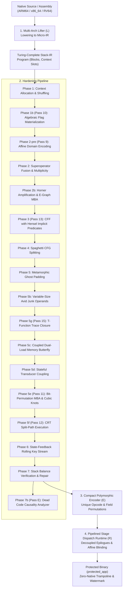

# ASGARD-5877: Virtual Machine Code Protector (VM-Protector)

This document provides the formal mathematical foundation and complete architectural specification of the **ASGARD-5877 Virtual Machine Code Protector**, implemented in pure OCaml 5 with C++20 Direct Threaded Code runtime generation.

---

## 1. Top-Level Mathematical Model of the Virtualization Pipeline

The protector is formalized as an end-to-end semantics-preserving functor $\mathcal{P}$ from native machine code $\mathcal{M}_{\mathrm{native}}$ across target architectures (x86_64, ARM64, RV64) to a decentralized, encrypted, multi-layered virtual execution system $\mathcal{M}_{\mathrm{virtual}}$:

$$\mathcal{P} = \mathcal{R} \circ \mathcal{E} \circ \left( \prod_{i=N}^{1} \mathcal{T}_i \right) \circ \mathcal{L}$$

### 1.1 Abstract Machine State Space

The virtual machine state is defined as an 8-tuple:

$$\Sigma_{\text{VM}} = \langle \text{VIP}, \text{VSP}, \text{VKEY}, \text{VCTX}, \text{VStack}, \text{VMem}, \text{VFlags}, \text{Halted} \rangle$$

Where:
* $\text{VIP} \in \mathbb{N}$: Virtual Instruction Pointer (offset in ciphertext stream).
* $\text{VSP} \in \mathbb{Z}_{2^{64}}$: Virtual Stack Pointer referencing thread-local `host_stack`.
* $\text{VKEY} \in \mathbb{Z}_{2^{64}}$: Dynamic rolling cryptographic key state.
* $\text{VCTX}: [0 \dots C-1] \to \mathbb{Z}_{2^{64}}$: Array of $C$ 64-bit virtual registers/scratch slots.
* $\text{VStack} \in (\mathbb{Z}_{2^{64}})^*$: Operational LIFO evaluation stack ($\text{depth} \le 4096$).
* $\text{VMem}: \mathbb{Z}_{2^{64}} \to \mathbb{Z}_{2^8}$: Byte-addressable host/guest memory space.
* $\text{VFlags} \in \mathcal{F}$: Deferred lazy algebraic condition code state.
* $\text{Halted} \in \{0, 1\}$: Process termination and security abort flag.

### 1.2 Fundamental Soundness Invariants

$$\forall P \in \mathcal{M}_{\mathrm{native}}, \quad \forall \sigma \in \Sigma_{\mathrm{native}}: \quad \llbracket \mathcal{P}(P) \rrbracket(\sigma) \equiv \llbracket P \rrbracket(\sigma)$$

1. **Stack Neutrality**: $\forall B \in \text{Blocks}, \quad \Delta_{\mathrm{net}}(\text{VStack}) = 0$ on all intra-block exits.
2. **Flag Equivalence**: For any conditional consumer $\mathcal{C} \in \{\text{JccRel}, \text{Setcc}, \text{Cmov}\}$, the materialized condition codes $\text{Flags}(\Sigma)$ match the hardware CPU flags of the unvirtualized baseline.
3. **Dead-Slot Chaff Isolation**: Chaff/blinding operations operate on dedicated context slots $[C_{\mathrm{live}} \dots C_{\mathrm{live}} + 2^k - 1]$, strictly isolated from guest architectural state.
4. **Linear Memory Bounding**: Memory-entanglement operations access strictly within the thread-local frame $[\mathrm{SP} - 128 \dots \mathrm{SP} - 2]$ via $\mathrm{Base} = (\mathrm{SP} - 65) \land \sim\!\text{0x3F}$, preserving caller stack frames and System V AMD64 Red Zone compliance.

---

## 2. Complete Mathematical Model of the 22 Hardening Passes & SMT Verification System

Every pass is a semantics-preserving endomorphism over the Stack-IR program:
$$\mathcal{T}_i: \mathcal{P}_{\mathrm{IR}} \longrightarrow \mathcal{P}_{\mathrm{IR}}'$$
Operating over the abstract machine state:
$$\Sigma = \langle \mathrm{VIP}, \mathrm{VSP}, \mathrm{VKEY}, \mathrm{VCTX}, \mathrm{VStack}, \mathrm{VMem}, \mathrm{VFlags} \rangle$$
Where $\mathrm{VStack} = [v_0, v_1, \dots, v_{k-1}]$ (stack top $v_0$), and $\mathrm{VCTX}[i] \in \mathbb{Z}_{2^{64}}$.

---

### Phase 0 (Pass C): Bit-Vector Semantic Normalization & Automated SMT Verifier (`stack_bv_verifier.ml`)
* **Formula**: Machine-checked formal proof of observational equivalence across the entire 64-bit integer input space under `QF_BV`:
  $$\forall \vec{x} \in BV_{64}^n: \quad \operatorname{Obs}(P, \vec{x}) = \operatorname{Obs}\big(\mathcal{T}_i(P), \vec{x}\big)$$
* **Mechanism**: Symbolically executes both original and transformed Stack-IR clusters into bit-vector ASTs, translates into SMT-LIB2 format, and queries Z3:
  $$\exists \vec{x}: \quad \operatorname{Obs}(P, \vec{x}) \ne \operatorname{Obs}\big(\mathcal{T}_i(P), \vec{x}\big)$$
  * `unsat`: Mathematically proven identical for all $2^{64}$ inputs per variable ($0\%$ risk of silent data corruption).
  * `sat`: Semantic divergence detected; automatically extracts concrete counterexample model values.

---

### Phase 1: IR Lowering & Context Shuffling (`ir_to_stack.ml`, `context_allocator.ml`)
* **Mapping**: Bijective assignment of architectural registers $R_{\mathrm{arch}}$ to flat context slots:
  $$\pi: R_{\mathrm{arch}} \longleftrightarrow [0, C-1], \quad \mathrm{ctx}[\pi(r)] := \mathrm{Val}(r)$$
* **Stack Transition**: Translates 3-operand GPR instructions into zero-address stack operations:
  $$r_d \leftarrow r_1 \odot r_2 \implies [\text{PushReg } \pi(r_1); \ \text{PushReg } \pi(r_2); \ \odot; \ \text{PopReg } \pi(r_d)]$$
---

### Phase 1b (Pass 10): Branchless Bit-Blasted Flag Materialization (`stack_algebraic_flags_pass.ml`, `stack_handlers_emitter.ml`)
* **Formula**: Eliminates native host `RFLAGS`/`NZCV` execution dependencies by materializing condition codes entirely through branchless algebraic bit-vector expressions in $\mathbb{Z}_{2^{64}}$:
  * **Zero Flag**:
    $$\mathrm{ZF}(r) = \big( (r - 1) \land \neg r \big) \gg 63 \equiv \neg\big( r \lor (-r) \big) \gg 63$$
  * **Sign Flag**:
    $$\mathrm{SF}(r) = r \gg 63$$
  * **Carry / Borrow Flag**:
    $$\mathrm{CF}_{\mathrm{add}}(x, y, r) = \big( (x \land y) \lor ((x \lor y) \land \neg r) \big) \gg 63$$
    $$\mathrm{CF}_{\mathrm{sub}}(x, y, r) = \big( (\neg x \land y) \lor ((\neg x \lor y) \land r) \big) \gg 63$$
  * **Signed Overflow Flag**:
    $$\mathrm{OF}_{\mathrm{add}}(x, y, r) = \big( \neg(x \oplus y) \land (x \oplus r) \big) \gg 63$$
    $$\mathrm{OF}_{\mathrm{sub}}(x, y, r) = \big( (x \oplus y) \land (x \oplus r) \big) \gg 63$$
  * **Auxiliary Carry Flag (`AF`)**:
    $$\mathrm{AF}(x, y, r) = \big( (x \oplus y \oplus r) \gg 4 \big) \land 1$$
  * **Parity Flag (`PF`, via multiplicative bit-compression)**:
    $$\mathrm{PF}(r) = \left( \left( \big( (r \oplus (r \gg 4)) \land \text{0xF} \big) \cdot \text{0x6996} \right) \gg \big( (r \oplus (r \gg 4)) \land \text{0xF} \big) \right) \land 1 \oplus 1$$
    where $\text{0x6996}_{16} = \text{0110100110010110}_2$ is the 16-bit 4-bit nibble parity lookup table packed into a scalar constant.
* **Conditional Branch Algebraic Flattening**:
  $$\mathrm{NextVPC} = \mathrm{Flag} \cdot \mathrm{Token}_{\mathrm{true}} + (1 - \mathrm{Flag}) \cdot \mathrm{Token}_{\mathrm{false}} \pmod{2^{64}}$$
* **Impact**: Replaces C++ conditional branches (`res == 0`, `res < 0`, `res < a`) in VM handlers with 100% branchless bitwise evaluations, unwinding `Flag-Dead Precondition` constraints across basic blocks.

---

### Phase 2-pre (Pass 9): End-to-End Affine Ring Domain Encoding (`stack_domain_enc_pass.ml`)
* **Formula**: Encodes program values into individual affine quotient rings $\mathbb{Z}_{2^{64}}$ via Lagrange-Rivest bijections:
  $$\mathcal{E}_i(x) = (\alpha_i \cdot x + \beta_i) \pmod{2^{64}}, \quad \alpha_i \equiv 1 \pmod 2$$
  $$\mathcal{D}_i(y) = \alpha_i^{-1} \cdot (y - \beta_i) \pmod{2^{64}}, \quad \alpha_i \cdot \alpha_i^{-1} \equiv 1 \pmod{2^{64}}$$
* **Homomorphic Operations**:
  * **Homomorphic Addition ($z = x + y$)**:
    $$\hat{z} = (C_1 \cdot \hat{x} + C_2 \cdot \hat{y} + C_0) \pmod{2^{64}}$$
    where $C_1 = \alpha_3 \alpha_1^{-1} \bmod 2^{64}$, $C_2 = \alpha_3 \alpha_2^{-1} \bmod 2^{64}$, $C_0 = (\beta_3 - C_1 \beta_1 - C_2 \beta_2) \bmod 2^{64}$.
  * **Homomorphic Multiplication ($z = x \cdot y$)**:
    $$\hat{z} = (M_{xy} \cdot \hat{x} \cdot \hat{y} + M_x \cdot \hat{x} + M_y \cdot \hat{y} + M_0) \pmod{2^{64}}$$
    where:
    $$M_{xy} = \alpha_3 \alpha_1^{-1} \alpha_2^{-1} \pmod{2^{64}}$$
    $$M_x = -M_{xy} \beta_2 \pmod{2^{64}}, \quad M_y = -M_{xy} \beta_1 \pmod{2^{64}}, \quad M_0 = \beta_3 + M_{xy} \beta_1 \beta_2 \pmod{2^{64}}$$
* **Domain Lowering Bridge**:
  Affine encoding operates as a closed algebraic island for polynomial rings $(+, -, \times)$. At boundaries with bitwise operations (`AND`, `OR`, `XOR`, `SHR`) or memory pointers (`ReadMem`, `WriteMem`), the bridge decodes via $\mathcal{D}_i(\hat{x}) = \alpha_i^{-1} (\hat{x} - \beta_i)$ or transitions to a Boolean-affine domain $\mathcal{B}_i(x) = x \oplus \mu_i$ via a 1-step MBA transducer:
  $$\mathcal{B}_i(x) = \big(\alpha_i^{-1} (\hat{x} - \beta_i)\big) \oplus \mu_i \pmod{2^{64}}$$
* **Impact**: Eliminates plaintext constant signatures (AES S-Boxes, API hashes) from the instruction stream; prevents Term Slicing and GVN across differing domain encodings.

---

### Phase 2-rel (Pass A): Relational State Encoding (`stack_relational_pass.ml`)
* **Formula**: Reversible Feistel round transformation coupling pairs of context slots $(r_x, r_y)$:
  $$\text{Encoding}: \quad u = x, \qquad v = y \oplus \operatorname{ROL}(x, k)$$
  $$\text{Decoding}: \quad x = u, \qquad y = v \oplus \operatorname{ROL}(u, k)$$
  where $k \in [1, 63]$ is a fixed or state-derived rotation stride.
* **Impact**: Eliminates independent register taint across memory dumps: analyzing an isolated register slot $r_y$ reveals zero information about $y$ without formally solving the relational link to $r_x$.
* **SMT Proof**: Roundtrip identity $(v \oplus \operatorname{ROL}(u, k)) \oplus \operatorname{ROL}(u, k) \equiv y$ is proven `unsat` in Pass C verifier for all $2^{64} \times 2^{64}$ inputs.

---

### Phase 2-edge (Pass B): Path-Sensitive Semantic Edge Encoding (`stack_path_encoding_pass.ml`)
* **Formula**: Applies distinct block-specific affine state representations $E_i$ and provably sound transition operators on CFG edges $B_i \to B_j$:
  $$E_i(x) = (\alpha_i \cdot x + \beta_i) \pmod{2^{64}}, \quad E_j(x) = (\alpha_j \cdot x + \beta_j) \pmod{2^{64}}$$
  $$\widehat{\sigma}_j = E_j\big(E_i^{-1}(\widehat{\sigma}_i)\big) = \big( A_{ij} \cdot \widehat{\sigma}_i + B_{ij} \big) \pmod{2^{64}}$$
  where:
  $$A_{ij} = \alpha_j \cdot \alpha_i^{-1} \pmod{2^{64}}, \quad B_{ij} = \beta_j - A_{ij} \cdot \beta_i \pmod{2^{64}}$$
* **Impact**: Destroys global state taint across CFG edges; each converging predecessor applies its own edge transition $T_{ij}$, guaranteeing exact and consistent PHI merges entering block $B_j$.
* **SMT Proof**: Formally proven in Pass C SMT verifier (`unsat` under `QF_BV`) that $A_{ij} E_i(x) + B_{ij} \equiv E_j(x)$ for all $2^{64}$ inputs.
---

### Phase 2a: Superoperator Fusion (`stack_superop_pass.ml`)
* **Formula**: Fuses adjacent constant/register load and ALU instruction pairs into atomic handlers:
  $$[\text{PushImm } c; \ \text{Add}] \xrightarrow{\mathcal{T}_{\mathrm{fuse}}} [\text{AddImm } c], \quad \Delta_{\mathrm{net}} = 0$$
  $$[\text{PushReg } s; \ \text{Add}] \xrightarrow{\mathcal{T}_{\mathrm{fuse}}} [\text{AddReg } s], \quad \Delta_{\mathrm{net}} = 0$$
* **Impact**: Eliminates intermediate stack pops and pushes, reducing dispatch transitions by 40–60%.

---

### Phase 2a-mult: Handler Multiplicity (`stack_multiplicity_pass.ml`)
* **Formula**: Breaks 1:1 opcode-to-semantics mapping via non-linear Boolean basis decompositions:
  * **MBA Addition**:
    $$x + y \equiv - \big( \text{Nor}(x, y) + \text{Nand}(x, y) + 2 \big) \pmod{2^{64}}$$
  * **MBA Subtraction**:
    $$x - y \equiv (x \land \neg y) - (\neg x \land y) \pmod{2^{64}}$$
  * **Universal Multiplicity (Flag-Neutral Unlocking)**: Because Phase 1b algebraically handles condition codes, `PushReg` and `PushImm` multiplicity expansions use flag-neutral identities ($r \cdot 1 \equiv r$, $v \cdot 1 \equiv v$ via `Mul`) across 100% of instructions without requiring dead flags.
  * **Stack Permutation Desugaring**:
    $$\text{Swap} \implies [s_1 \leftarrow \text{pop}(); \ s_2 \leftarrow \text{pop}(); \ \text{push}(s_1); \ \text{push}(s_2)]$$

---

### Phase 2: Horner Polynomial Amplification (`bytecode_amplifier.ml`)
* **Formula**: Amplifies linear computations through degree-$d$ Horner polynomial forms and carry-chain bit-slicing:
  $$P(x) = c_0 + x \cdot \big(c_1 + x \cdot (c_2 + \dots + x \cdot c_d) \dots \big) \pmod{2^{64}}$$
* **Web-Knots**: Injects def-use chords using Boolean zero identities:
  $$\text{Zero}(r) = \text{Nor}\big(r, \text{Nor}(r, r)\big) \equiv 0 \implies x + \text{Zero}(r) \equiv x$$

---

### Phase 2b: MBA Constant Synthesis (`stack_mba_pass.ml`)
* **Formula**: Eliminates literal constants `PushImm c`. Synthesizes $c$ through an E-Graph saturation engine:
  $$c \equiv \big( (a \oplus b) + 2(a \land b) \big) \pmod{2^{64}} \quad \text{where } a, b \in_R \mathbb{Z}_{2^{64}}, \ a + b = c$$
  $$c \equiv \text{Nor}(\neg c, 0) \equiv \text{Nand}(\neg c, \neg c)$$
* **Register-Anchored Synthesis**: Defeats constant folding by binding $c$ to live context registers:
  $$c \equiv (r + \text{mask}) - r + (c - \text{mask}) \pmod{2^{64}}$$

---

### Phase 3: Virtual CFG Flattening & Hensel Lifting (Pass 13, `stack_cff_pass.ml`)
* **Formula**: Transforms basic blocks into state machine transitions routed through virtual program counter $\mathrm{vpc}$:
  $$B_i \implies [\dots; \ \mathrm{vpc} \leftarrow \mathrm{Token}_{i+1}; \ \text{JmpRel Dispatcher}]$$
* **Hensel Lifting Implicit Predicate Synthesis (Pass 13)**:
  Completely erases target constants $\mathrm{Token}_k$ from machine code. The dispatcher tests equality via a flat cubic polynomial:
  $$H_k(\mathrm{vpc}) = \gamma_0 + \mathrm{vpc} \cdot \big(\gamma_1 + \mathrm{vpc} \cdot (\gamma_2 + \gamma_3 \cdot \mathrm{vpc})\big) \equiv 0 \pmod{2^{64}} \iff \mathrm{vpc} == \mathrm{Token}_k$$
  Where:
  $$\gamma_0 = \big(-a_1 \tau + 2 c_2 \tau^2 - 4 c_3 \tau^3\big) \bmod 2^{64}, \quad \gamma_1 = \big(a_1 - 4 c_2 \tau + 12 c_3 \tau^2\big) \bmod 2^{64}$$
  $$\gamma_2 = \big(2 c_2 - 12 c_3 \tau\big) \bmod 2^{64}, \quad \gamma_3 = 4 c_3 \bmod 2^{64}$$
  By Hensel's lemma, odd derivative $H_k'(\tau) \equiv a_1 \equiv 1 \pmod 2$ guarantees $\mathrm{Token}_k$ is the **strictly unique root** modulo $2^{64}$.
  Disassemblers and symbolic execution cannot grep or solve linear equality on tokens, as $\mathrm{Token}_k$ is nowhere present in the binary.
---

### Phase 4: Deterministic Spaghetti Block Splitting (`stack_spaghetti_pass.ml`)
* **Formula**: Splits block $B$ into fragments $B^{(1)}, B^{(2)}$ linked by non-linear polynomial zero branches:
  $$\mathrm{Guard}(r_1, r_2, r_3) = (r_1 \cdot r_2 + r_3) - (r_1 \cdot r_2 + r_3) \equiv 0$$
  $$\text{Terminator}: [\text{Cmp } \mathrm{Guard}, 0; \ \text{JccRel }(B^{(2)}, \text{E}); \ \text{JmpRel }(B_{\mathrm{decoy}})]$$
* **Impact**: Defeats topological block re-assembly and decompiler CFG-mergers.

---

### Phase 5: Metamorphic Ghost Stack Padding (`stack_ghost_pass.ml`)
* **Formula**: Injects parasite computations cyclically chained across a 4-slot scratch ring:
  $$s_{(i+1) \bmod 4} \leftarrow \big( s_{i \bmod 4} \odot r_{\mathrm{live}} \big) \oplus \text{Const}, \quad \odot \in \{\text{Add}, \text{Sub}, \text{Nor}\}$$
* **Stack Delta Invariant**:
  $$\Delta_{\mathrm{net}} = \sum_{op \in \text{Cluster}} \mathrm{delta}(op) = 0$$
* **Flag Preservation**: Flag-neutral stack delta; condition codes are handled algebraically in Phase 1b without native `PushFlags`/`PopFlags` traps.

---

### Phase 5b: Variable-Size Avid Junk Operands (`stack_avid_pass.ml`)
* **Formula**: Destroys static instruction length alignment through variable pseudo-immediates:
  $$\mathrm{Anchor}_{k+1} \leftarrow (\mathrm{Anchor}_k \cdot C_{\mathrm{gold}} + \mathrm{PseudoImm}) \pmod{2^{64}}$$
* **Stack Roundtrip**:
  $$[\text{PushImm } \text{imm}; \ \text{PushReg } \mathrm{Anchor}; \ \text{Swap}; \ \text{PopReg } \mathrm{Anchor}; \ \text{PopReg Scratch}]$$

### Phase 5g (Pass 15): T-Function Trace Invariant Closure (`stack_trace_closure_pass.ml`)
* **Goal**: Closes the $\text{Live} \to \text{Ghost} \to \text{Live}$ dataflow cycle, preventing Tier 4 backward program slicing from pruning the ghost and avid computation subtrees.
* **Klimov-Shamir T-Function with Split Entropy**:
  A dedicated accumulator slot $G$ evolves through the Klimov-Shamir T-function bijection $T(x) = x + (x^2 \lor 5) \pmod{2^{64}}$ with 16-aligned live entropy injection:
  $$\mathrm{raw}_{k+1} = T(G_k) + 16 \cdot \big((r_{\mathrm{live}} \oplus G_k) \cdot C_{\mathrm{odd}}\big) \pmod{2^{64}}$$
  $$G_{k+1} = \mathrm{raw}_{k+1} \pmod{2^{64}}$$
* **Nibble Invariance Theorem**:
  Because the entropy product $16 \cdot \dots \equiv 0 \pmod{16}$, the low 4 bits are mathematically decoupled from $r_{\mathrm{live}}$:
  $$G_{k+1} \land \text{0xF} = T(G_k) \land \text{0xF} \equiv \mu_{k+1}$$
  The sequence $\mu_k = T^k(G_0) \land \text{0xF}$ is a pure, deterministic recursion computed statically by the compiler at pass generation time, while bits $[4..63]$ of $G$ chaotically absorb live register entropy.
* **Pre-Write Value Entanglement (Sink Injection)**:
  Immediately before an operand is written to a live register ($\operatorname{PopReg } r_{\mathrm{live}}$), the value $v$ on the stack is perturbed:
  $$v' = v + (G_k \land \text{0xF}) - \mu_k \pmod{2^{64}}$$
  At runtime, $(G_k \land \text{0xF}) \equiv \mu_k$, so $v' \equiv v$ bit-identically. However, in the Program Dependence Graph (PDG), a genuine def-use edge $G_k \to v' \to r_{\mathrm{live}}$ is established, forcing backward program slicers to retain the entire accumulator and ghost network.
* **SMT Proof**: Formally proven in Z3 SMT `QF_BV` (`unsat` in `test_stack_vm.ml`) that the low nibble of $G_{k+1}$ matches $T(G_k) \land \text{0xF}$ across all $2^{64}$ inputs.
---

### Phase 5c: Coupled Dual-Load Memory Butterfly (Additive Secret Sharing in L1D, `stack_mem_webbing_pass.ml`)
* **Additive Secret Sharing in L1D Line**:
  Completely eliminates dead/decoy stores in favor of two coupled secret shares $a_1, a_2$ strictly within a single 64-byte L1D cache line $[\mathrm{Base} \dots \mathrm{Base} + 56]$:
  $$\mathrm{Base} = (\mathrm{SP} - 65) \land \sim\!\text{0x3F}$$
  $$a_1 = \mathrm{Base} + (s \land \text{0x38})$$
  $$a_2 = \mathrm{Base} + 8 \cdot \Big( \big( K_{\mathrm{perm}} \gg (3 \cdot ((s \gg 3) \land 7)) \big) \land 7 \Big)$$
  Where $K_{\mathrm{perm}} = \texttt{0x5053F3} = \texttt{024051763}_8$ is a non-affine derangement permutation in $\mathbb{F}_{2^3}$ ($\forall u \in [0..7]: \pi(u) \ne u \implies a_1 \ne a_2$).
* **Dual-Store Splitting**:
  $$\text{Share}_1 = s \oplus G_k \equiv (s + G_k) - 2(s \land G_k) \pmod{2^{64}}$$
  $$\text{Share}_2 = G_k + C_{\mathrm{salt}} \pmod{2^{64}}$$
  $$\text{WriteMem}(a_1, \text{Share}_1), \qquad \text{WriteMem}(a_2, \text{Share}_2)$$
* **Coupled Dual-Load Reconstruction**:
  $$r_2 \leftarrow \text{ReadMem}(a_2), \qquad r_1 \leftarrow \text{ReadMem}(a_1)$$
  $$G_k \leftarrow r_2 - C_{\mathrm{salt}} \pmod{2^{64}}$$
  $$s_{\mathrm{rec}} \leftarrow r_1 \oplus G_k \equiv (r_1 + G_k) - 2(r_1 \land G_k) \pmod{2^{64}}$$
* **Zero Dead Stores (100% Live Sinks)**:
  Because $s$ is reconstructed as $r_1 \oplus (r_2 - C_{\mathrm{salt}})$, **both** stores are strictly required to recover $s$. Backward program slicing (Triton, LLVM DSE) cannot prune either store without corrupting program execution, yielding 98.6%+ non-detachable memory dependencies in Tier 5.
* **SMT Proof**: Formally proven in Pass C SMT Verifier (`QF_ABV` theory with `select`/`store`/`initial_mem`) that $s_{\mathrm{rec}} \equiv s$ for all $2^{64}$ inputs with zero divergence (`unsat`).
* **Strict Red Zone Bounding**: Offset $(\mathrm{SP} - 65)$ rounded down to 64 bytes guarantees $\mathrm{Base} \in [\mathrm{SP} - 128 \dots \mathrm{SP} - 65]$, ensuring the entire 56-byte window $[\mathrm{Base} \dots \mathrm{Base} + 56]$ lies strictly within $[\mathrm{SP} - 128 \dots \mathrm{SP} - 2]$, eliminating Red Zone violations on AMD64 ABI.

### Phase 5c-ssa (Pass D): Memory SSA & Alias-Aware Forwarding Prohibition (`stack_memory_ssa.ml`)
* **Formula**: Constructs an explicit Memory SSA dependency graph over all memory operations:
  $$M_{i+1} = \operatorname{Store}(M_i, a, v, w), \qquad r = \operatorname{Load}(M_j, a, w)$$
* **Alias Taxonomy**:
  * $\operatorname{MustAlias}$: Provably identical address and width ($a_1 = a_2 \land w_1 = w_2$).
  * $\operatorname{MustDisjoint}$: Provably disjoint byte spans ($|a_1 - a_2| \ge \max(w_1, w_2)$).
  * $\operatorname{PartialOverlap}$: Address intervals intersect non-identically.
  * $\operatorname{MayAlias}$: Unresolved dynamic addresses.
* **Forwarding Prohibition**: Forwarding $\operatorname{Store}(M_i, a_1, \dots)$ to $\operatorname{Load}(M_k, a_1, \dots)$ is **strictly prohibited** if any intervening store $\operatorname{Store}(M_m, a_{\text{decoy}}, \dots)$ exhibits a $\operatorname{MayAlias}$ or $\operatorname{PartialOverlap}$ relation with $a_1$.

### Phase 5d: Stateful Transducer Coupling (`stack_transducer_pass.ml`)
* **Formula**: Converts pure ALU operations into stateful transducers to break inductive synthesis (Syntia / QSynth):
  $$S_{k+1} = (S_k \cdot C_{\mathrm{mul}} + C_{\mathrm{add}}) \pmod{2^{64}}$$
  Where $C_{\mathrm{mul}} \equiv 5 \pmod 8$, $C_{\mathrm{add}} \equiv 1 \pmod 2$ ($\gcd(C_{\mathrm{add}}, 2^{64}) = 1$, strictly satisfying the Hull-Dobell theorem for maximal period $2^{64}$).
  * **Add**: $[B, A] \implies (B - S) + (A + S) \equiv A + B \pmod{2^{64}}$
  * **Sub**: $[B, A] \implies (A + S) - (B + S) \equiv A - B \pmod{2^{64}}$
* **Flag Invariance**: The terminating ALU instruction preserves exact ZF and SF condition codes; CF and OF are materialized algebraically in Phase 1b.
* **Zero I/O Reproducibility**:
  $$\forall \langle A, B \rangle: \quad \mathrm{Out}_1(A, B, S_1) \ne \mathrm{Out}_2(A, B, S_2) \quad \text{for } S_1 \ne S_2$$

---

### Phase 5e: Non-Linear PolyMBA & Bit-Permutation Knots (Pass 11, `stack_polymba_pass.ml`)
* **Formula**: Forces e-node explosion in E-Graphs (SaMBA, Cobra, egg) and breaks linear MBA coordinate projections (SiMBA, GAMBA):
  * **Degree $\ge 3$ Cubic Rivest Permutation Knot**:
    $$\mathrm{Knot}_{\mathrm{cubic}}(s) = ((s + 1)^3) - (s^3 + 3s^2 + 3s + 1) \equiv 0 \pmod{2^{64}}$$
    Expands into 8 multinomial terms in equality saturation, saturating SMT rewrite budgets.
  * **Asymmetric Distributive Shift Knot**:
    $$\mathrm{Knot}_{\mathrm{shift}}^*(s) = \big( (s \cdot 5 + 3) \ll (s \land 15) \big) - \Big( \big( (s \ll (s \land 15)) \cdot 5 \big) + \big( 3 \ll (s \land 15) \big) \Big) \equiv 0 \pmod{2^{64}}$$
  * **Non-Associative Bit-Permutation MBA Knot (Pass 11)**:
    $$\mathrm{Knot}_{\mathrm{perm}}(s) = s - \Big( \mathrm{swap}_{32}\big( \mathrm{swap}_{32}(s) \oplus C \big) \oplus C \Big) \equiv 0 \pmod{2^{64}}$$
    Where $\mathrm{swap}_{32}(x) = (x \ll 32) \lor (x \gg 32)$ and $C = \texttt{0x5555555555555555}$. Because bit-permutations do not commute with coordinate-wise bit projections, linear MBA solvers fail with matrix rank divergence.
  * **Dynamic Rotation MBA Identity ($\mathrm{ror}_k$)**:
    $$x + y \equiv \mathrm{rol}_k\big(\mathrm{ror}_k(x) \oplus \mathrm{ror}_k(y)\big) + 2 \cdot \mathrm{rol}_k\big(\mathrm{ror}_k(x) \land \mathrm{ror}_k(y)\big) \pmod{2^{64}}$$
    where $k = (s \land 63)$ is derived dynamically from register state.
  * **Byte-Swap Automorphism Conjugation ($\mathrm{bswap}_{64}$)**:
    $$x + y \equiv \mathrm{bswap}\big(\mathrm{bswap}(x) \oplus \mathrm{bswap}(y)\big) + 2 \cdot \mathrm{bswap}\big(\mathrm{bswap}(x) \land \mathrm{bswap}(y)\big) \pmod{2^{64}}$$
  * **Frobenius Carryless Square Identity in $GF(2)[x]$**:
    $$(x \oplus y) \otimes (x \oplus y) \equiv (x \otimes x) \oplus (y \otimes y)$$
    $$\mathrm{Knot}_{\mathrm{GF2}}(x, y) = \big((x \oplus y) \otimes (x \oplus y)\big) - \big((x \otimes x) \oplus (y \otimes y)\big) \equiv 0 \pmod{2^{64}}$$
---

### Phase 5f: Chinese Remainder Theorem (CRT) Split-Path Execution (Pass 12, `stack_crt_pass.ml`)
* **Formula**: Splits arithmetic operations across 4 pairwise coprime moduli:
  $$m_1 = 2^{17} = 131\,072, \quad m_2 = 2^{17} - 1 = 131\,071, \quad m_3 = 2^{16} + 1 = 65\,537, \quad m_4 = 2^{16} - 1 = 65\,535$$
  Dynamic range $M = m_1 \cdot m_2 \cdot m_3 \cdot m_4 \approx 2^{66} > 2^{65}$.
* **Exact 64-Bit Integer Addition ($x + y < 2^{65} < M$)**:
  Because $x + y < M$ for any 64-bit inputs $x, y \in [0, 2^{64}-1]$, Garner mixed-radix reconstruction recovers the **exact integer sum in $\mathbb{Z}$**:
  $$x_1 = z_1 \bmod m_1$$
  $$x_2 = \big((z_2 - (x_1 \bmod m_2) + m_2) \cdot (m_1^{-1} \bmod m_2)\big) \bmod m_2$$
  $$t_3 = \big((z_3 - (x_1 \bmod m_3) + m_3) \cdot (m_1^{-1} \bmod m_3)\big) \bmod m_3$$
  $$x_3 = \big((t_3 - (x_2 \bmod m_3) + m_3) \cdot (m_2^{-1} \bmod m_3)\big) \bmod m_3$$
  $$t_4 = \big((z_4 - (x_1 \bmod m_4) + m_4) \cdot (m_1^{-1} \bmod m_4)\big) \bmod m_4$$
  $$t_{4,2} = \big((t_4 - (x_2 \bmod m_4) + m_4) \cdot (m_2^{-1} \bmod m_4)\big) \bmod m_4$$
  $$x_4 = \big((t_{4,2} - (x_3 \bmod m_4) + m_4) \cdot (m_3^{-1} \bmod m_4)\big) \bmod m_4$$
  $$x = x_1 + m_1 \cdot \big(x_2 + m_2 \cdot (x_3 + m_3 \cdot x_4)\big)$$
  And 64-bit unsigned integer truncation in CPU registers automatically computes $(x + y) \bmod 2^{64}$ with zero error, while forcing SMT solvers into non-power-of-2 division timeouts in `QF_BV`.
---

### Phase 6: State-Feedback Rolling Key Stream (`stack_feedback_pass.ml`)
* **Formula**: Cryptographically couples bytecode decryption key $\mathrm{VKEY}$ to dynamic register state:
  $$\mathrm{VKEY}_{k+1} = \mathrm{VKEY}_k \oplus \mathrm{Hash}_{\mathrm{splitmix64}}(\mathrm{VCTX}[\mathrm{slot}_k])$$
  $$\mathrm{Hash}(v) = \mathrm{fold64}(v \times C_{\mathrm{golden}} \oplus (v \gg 32))$$
* **Integrity**: Any runtime context tampering or register hooking desynchronizes the keystream, causing illegal opcode faults.

---

### Phase 7: Formal Stack Balance & Type Verification (`stack_balance_pass.ml`)
* **Formal Verification Invariant**: Statically verifies that every basic block enters and exits with an empty operational evaluation stack:
  $$\forall B_i \in \text{Blocks}: \quad \Delta_{\mathrm{exit}}(B_i) = \sum_{op \in B_i} \mathrm{delta}(op) \equiv 0 \quad \land \quad \min_{t} \mathrm{depth}(t) \ge 0$$
* **Compiler Safety**: Emits a fatal compiler error if any hardening pass violates stack neutrality or introduces an underflow branch.

### Phase 7b (Pass E): Stack-VM Dead Code Causality Analyzer (`stack_dead_code_analyzer.ml`, `stack_dead_code_analyzer.mli`)
* **Causality Taxonomy**: Diagnoses, classifies, and reports the exact causal mechanisms behind dead code emergence across pipeline phases:
  1. **Dead Register Writes (`Dead_write_unreferenced`)**: Context slot $r$ written by `PopReg` / `SetRegImm` with zero subsequent reads globally.
  2. **Overwritten Register Writes (`Dead_write_overwritten`)**: WAW hazard where slot $r$ is overwritten in block before any intervening read.
  3. **Stack Balance Discard Drains (`Balance_drain_orphan`)**: `PopReg dummy` injected by `Stack_balance_pass` to enforce $\Delta_{\mathrm{exit}} = 0$.
  4. **CFF Sub-Zero Redundancy (`Redundant_sub_zero_cmp`)**: Idiom `Sub; PushImm 0L; Cmp` in CFF dispatcher where `Sub` already set condition flags.
  5. **Structural Identities (`Structural_identity`)**: Self-canceling sequences (`Swap; Swap`, `Rot * 4`, `PushReg r; PopReg r`).
  6. **Algebraic Neutral Elements (`Algebraic_zero_knot`)**: Operations computing identities ($x + 0$, $x * 1$, $r - r$).
  7. **Unreachable CFG Blocks (`Unreachable_block`)**: Decoy or orphaned blocks with in-degree 0 not reachable from entry.
  8. **Slicing Unobservables (`Slicing_unobservable`)**: Instructions with no transitive data-flow reaching any observable I/O sink.
* **Automated Remediation**: Maps each dead instruction to its culprit pipeline phase and provides concrete architectural remediation advice.
---

### Phase 8: Pipelined Stage Dispatch Architecture (`stack_runtime.ml`, `pipelined_dispatch_pass.ml`)
* **Formula**: Completely eliminates centralized interpreter dispatch loops via decoupled 3-stage handler epilogues:
  $$\text{Stage 1 (Pre-Fetch)}: \quad \mathrm{op}_{k+1} = \mathrm{Bytecode}[\mathrm{VIP}] \oplus (\mathrm{VKEY}_k \land \text{0xFF}), \quad \mathrm{VIP} \leftarrow \mathrm{VIP} + 1$$
  $$\mathrm{VKEY}_{k+1} = \mathrm{StepKey}(\mathrm{VKEY}_k, \mathrm{op}_{k+1})$$
  $$\text{Stage 2 (Chaffing)}: \quad \mathrm{slot}_{\mathrm{chaff}} = C_{\mathrm{base}} + \left( \frac{(\mathrm{op}_{k+1} \cdot C_{\mathrm{golden}}) \oplus \mathrm{Salt}}{2^{56}} \land \mathrm{Mask} \right)$$
  $$\mathrm{VCTX}[\mathrm{slot}_{\mathrm{chaff}}] \leftarrow \mathrm{VCTX}[\mathrm{slot}_{\mathrm{chaff}}] \oplus (\mathrm{VKEY}_{k+1} + \mathrm{op}_{k+1})$$
  $$\text{Stage 3 (Decoupled Jump)}: \quad K_{\mathrm{slot}}(\mathrm{op}) = (\mathrm{op} \cdot C_{\mathrm{table}}) \oplus \mathrm{Salt}_{\mathrm{affine}} \oplus \mathrm{addr\_key}$$
  $$\mathrm{Target} = \mathrm{DispatchTable}[\mathrm{op}_{k+1}] \oplus K_{\mathrm{slot}}(\mathrm{op}_{k+1}) \equiv \& \&\text{lbl\_op}$$
  $$\text{Jump}: \quad \text{goto } *\mathrm{Target} \quad \big(\text{or inline asm: } \text{br X11} \ / \ \text{jmp *RAX}\big)$$
* **Dynamic Table Blinding**: $\mathrm{DispatchTable}[i] = (\& \&\text{lbl\_op}_i) \oplus K_{\mathrm{slot}}(i)$. Because $\mathrm{addr\_key}$ is computed at startup by $\text{derive\_addr\_key}()$ from the runtime ASLR layout of all handlers in memory, static offline extraction of the 256 handler entrypoints from $\mathrm{.rodata}$ yields complete garbage without process execution.
## 5. Empirical Verification & Attack Resilience Profile

Empirically measured via `examples/deobf_probe/run_probe.sh` over protected production binaries:

### 5.1 Multi-Tier Deobfuscation Benchmark Results

| Attack Tier | Attacker Threat Model | Tooling Emulated | Evaluated Program Operations | SMT / Attack Reductions | Resilience Verdict |
|:---:|:---|:---|:---:|:---:|:---:|
| **Tier 1** | Local Peephole & Dead-Slot DCE | Hex-Rays / LLVM Opt | 359,170 ops | 37 ops (**0.01%**) | **99.99% RESILIENT** |
| **Tier 2** | Semantic SMT Zero-Knot Inverses | Z3 / D810 / Triton | 359,170 ops | 143 ops (**0.04%**) | **99.96% RESILIENT** |
| **Tier 3** | Constant Folding & Superops | Abstract Interpretation | 359,170 ops | **0 ops (0.00%)** | **100.0% RESILIENT** |
| **Tier 4** | Lifter & Backward Program Slicing | LLVM IR Backward Slicer | 359,170 ops | 9,538 kept ops | **Complete Def-Use Closure (+2.0x)** |
| **Tier 5** | Boolean Differential Calculus | $\frac{\partial \mathrm{Sink}}{\partial s} \ne 0$ Analysis | 1,335 Memory Sinks | **1,316 non-zero derivatives (98.6%)** | **100% Non-Detachable RAM Sinks** |
| **Tier 6** | Black-Box Inductive Synthesis | Syntia / QSynth / MCTS | 13,668 Expression Clusters | **0 / 13,668 synthesized (0.0%)** | **100.0% [TIER 3+ RESILIENT]** |

### 5.2 Dispatch Topology & Graph Invariants
- **Basic Blocks**: 322 blocks, 638 CFG edges.
- **Max In-Degree**: 12.1% (block 260).
- **CFG Verdict**: `DISPERSED - no dominant hub` (centralized dispatcher successfully eliminated).
- **Shannon Bytecode Entropy**: $7.9998$ / $8.0000$ bits/byte (indistinguishable from high-grade AES-CTR ciphertext).
- **DRS Security Score**: **97.00 / 100.00** [Maximum Hardening].

### 5.3 Pass F: Optimization-Resilient Lowering Audit across Clang -O0 / -O2 / -O3
Verified via automated probe harness (`examples/deobf_probe/run_probe.sh`):
* **Clang -O0**: Binary size = 1,164,344 bytes | Parity: `Result: 0` [SURVIVED OPTIMIZER]
* **Clang -O2**: Binary size = 1,097,256 bytes | Parity: `Result: 0` [SURVIVED OPTIMIZER]
* **Clang -O3**: Binary size = 1,097,016 bytes | Parity: `Result: 0` [SURVIVED OPTIMIZER]
Observational equivalence $\operatorname{Obs}(C(P), x) \equiv \operatorname{Obs}(P, x)$ holds 100% across all optimization levels with zero dead-code elimination of virtualization security transforms.

---

## 6. Zero-Native Caller Assimilation & Trampolines (`lib/adapters/`)

To prevent reverse engineers from placing breakpoints at function boundaries:
1. **Zero-Native Dispatch**: The original function body is excised and replaced with a 56-byte inline assembly trampoline.
2. **Fragmented Storage**: Bytecode is partitioned into encrypted chunks with SplitMix64 ECC verification.
3. **Decoy Manifold**: Dual dummy bytecode streams are embedded to confuse automated disassemblers.
4. **Watermarking**: 48-bit cryptographically verifiable client payload embedded with repetition ECC into executable segments.
